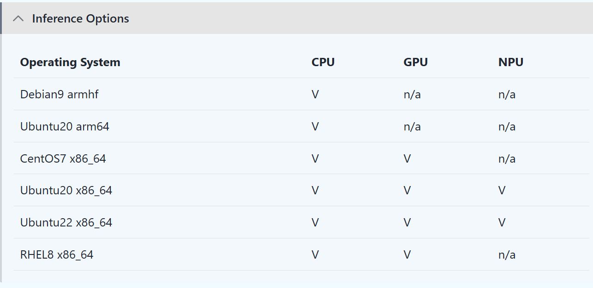
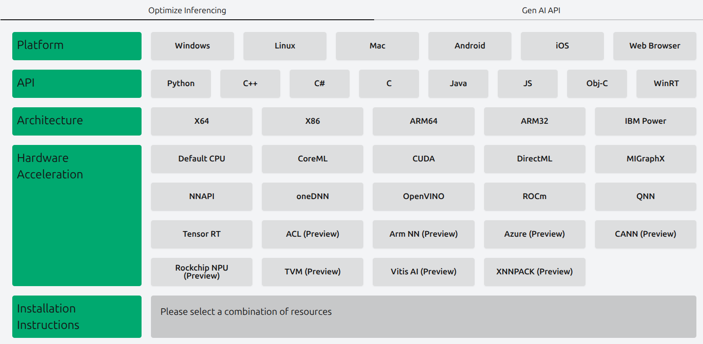
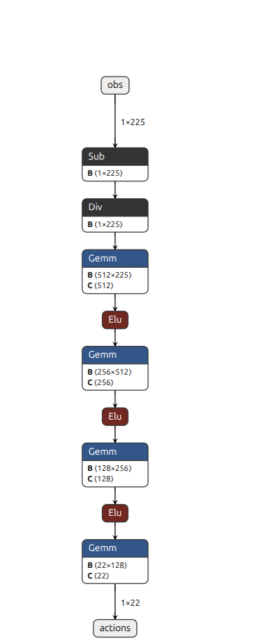
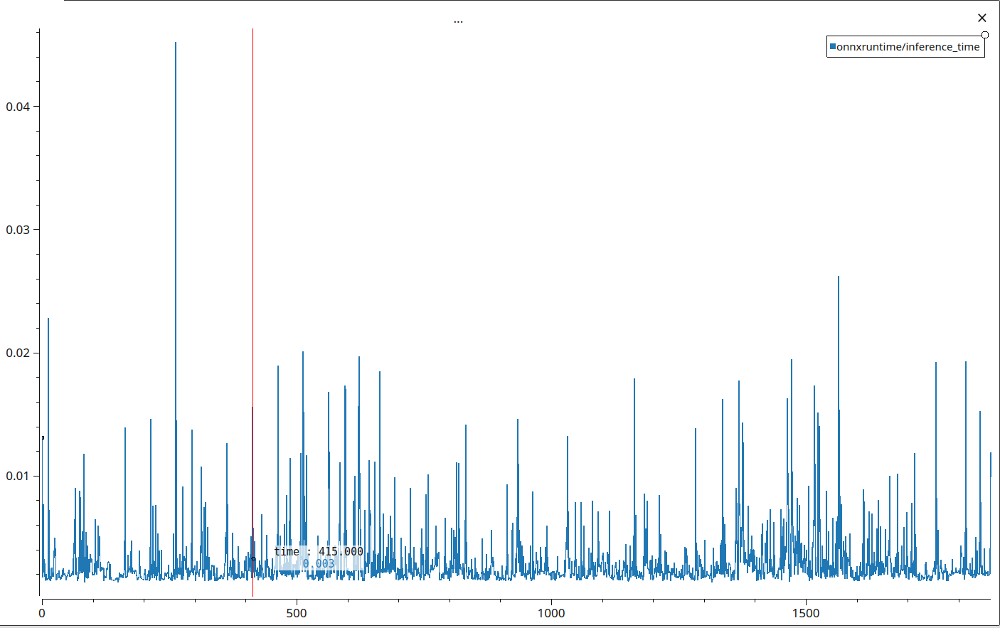
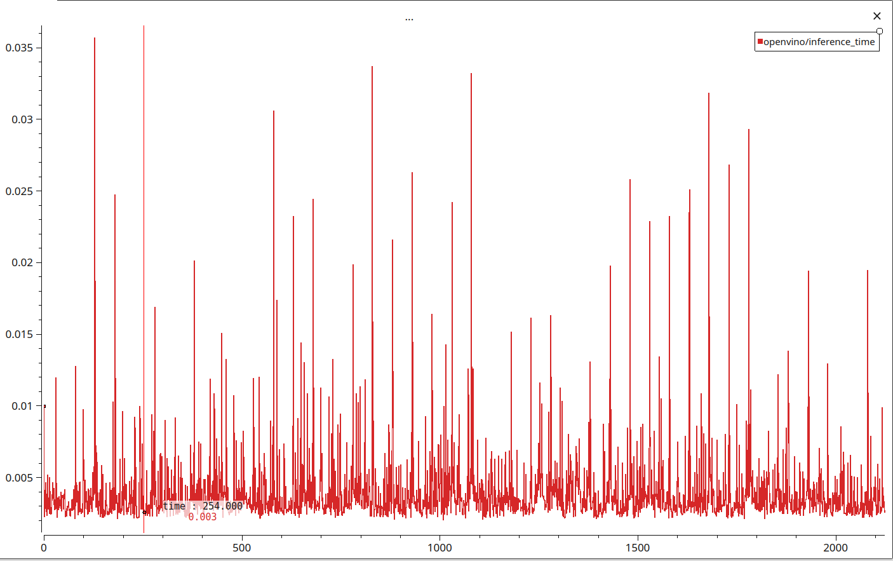
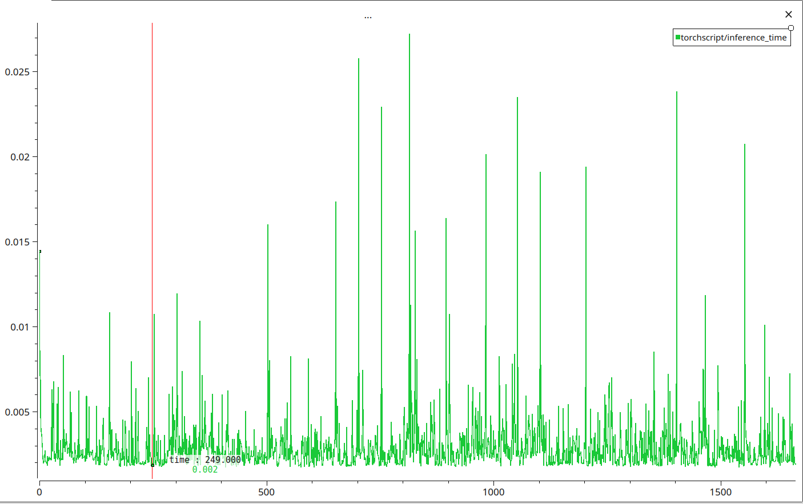
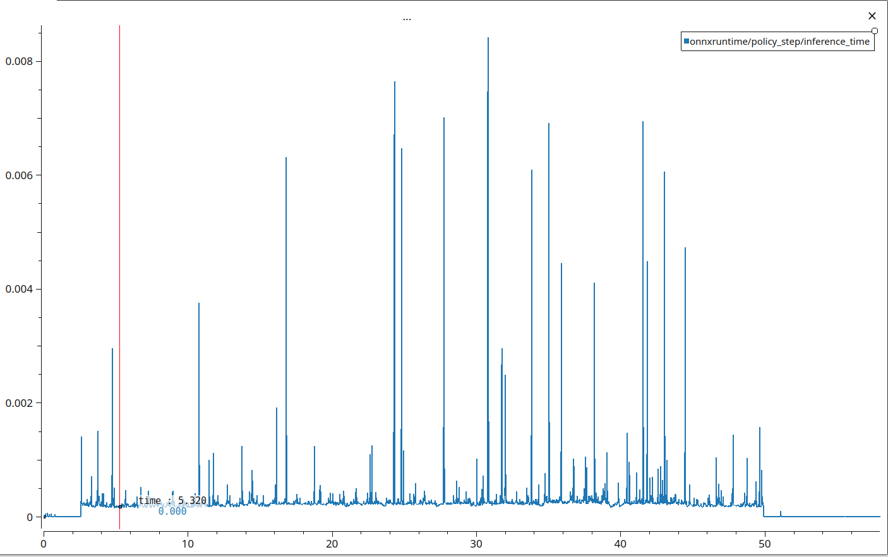
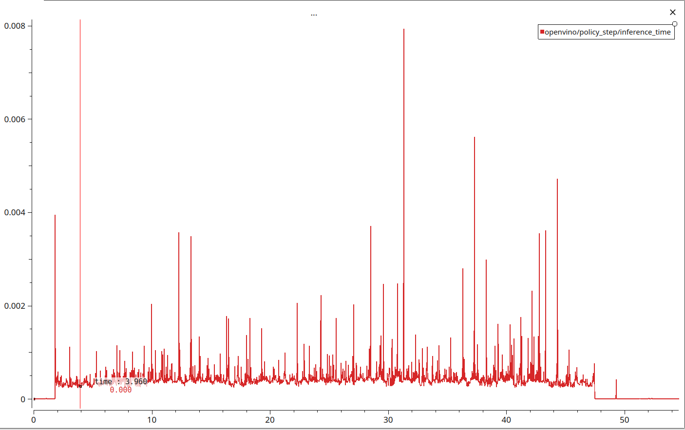
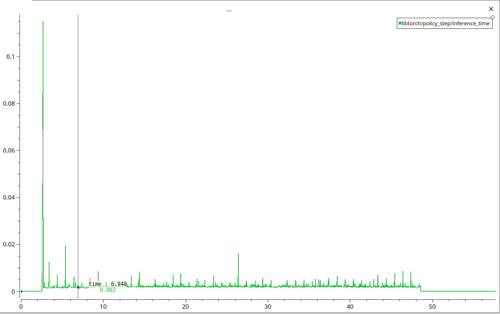

本文对比三种神经网络推理架构（LibTorch，OpenVino，OnnxRuntime）的推理速度区别，涵盖了Python和C++两种语言的对比。
## 推理架构介绍
### LibTorch
LibTorch是PyTorch官方提供的Torch C++接口库，提供了与PyTorch类似的接口来进行张量操作。考虑使用LibTorch是因为训练框架使用了PyTorch，导出的JIT Script可以直接使用LibTorch载入。安装LibTorch的流程如下：
1. 确保有一个python3.10的环境
    
    在终端中输入`python`可以进入python解释器，看到输出的提示信息中有版本信息。
    如果现有的python不是3.10，可以安装一个miniconda，创建一个python3.10的环境。
    ```bash
    # 安装好miniconda后
    conda create -n env_name python=3.10
    ```
2. 下载[pytorch的whl文件](https://github.com/lupinjia/torch_whl_cpu)
    
    Pytorch官网也有提供whl文件下载，但那个whl文件只适用于x86架构的计算机。而Nvidia Jetson提供的whl文件需要有CUDA才能正常使用，所以我自己编译了一个whl文件，可以在RDKX5这种无CUDA的ARM计算机上使用。

3. 安装Pytorch

    ```bash
    export TORCH_INSTALL=path/to/torch.whl
    python3 -m pip install --upgrade pip
    python3 -m pip install numpy
    python3 -m pip install --no-cache $TORCH_INSTALL
    ```

4. 将CMakeLists.txt的`set(CMAKE_PREFIX_PATH path)`中的path设为上述路径。
	
    使用`sudo find / -name "TorchConfig.cmake”`即可找到LibTorch库的位置，最后使用的CMAKE_PREFIX_PATH类似于`xxx/python3.10/dist-packages/torch/share/cmake/Torch`

5. 修改CMakeLists，将LibTorch添加到链接库中，然后就可以使用LibTorch的C++接口了。

    ```cmake
    # 根据自己的安装位置修改路径
    set(CMAKE_PREFIX_PATH /usr/local/lib/python3.10/dist-packages/torch/share/cmake/Torch)
    find_package(Torch REQUIRED)
    
    include_directories(
        ${TORCH_INCLUDE_DIRS})
    
    target_link_libraries(project_name
        ${TORCH_LIBRARIES}
        )
    ```

对于python来说，只需要`pip install torch`即可安装torch。

### OpenVino
OpenVino是Intel推出的神经网络推理框架，支持多平台多架构部署，并且在每种平台每种架构下都进行了特定的优化来确保性能。目前对于Linux来说，Openvino支持的操作系统及设备如下：



OpenVino官方提供了很详细的文档，参考[安装指引](https://docs.openvino.ai/2026/get-started/install-openvino/install-openvino-archive-linux.html)，顺利安装了OpenVino之后，就可以修改CMakeLists使用OpenVino了：
```cmake
find_package(OpenVINO REQUIRED COMPONENTS Runtime)
set(ov_link_libraries openvino::runtime)
target_link_libraries(project_name
    ${ov_link_libraries}
    )
```

python：`pip install openvino`

### OnnxRuntime
OnnxRuntime是一个专门使用onnx模型的多平台机器学习模型加速器，它具有灵活的接口，可以自由整合特定硬件的库。目前支持的平台如下：



将[onnxruntime release](https://github.com/microsoft/onnxruntime/releases) 中的对应版本的压缩包下载下来，解压后有头文件（`include`）和库文件（`lib`），在CMakeLists中根据当前CPU架构选择对应的库文件使用即可：
```cmake
# ---------------------------------------------------------------
# onnxruntime (vendored C++ SDK in third_party/onnxruntime)
#   lib/<arch>/ : arch-specific prebuilt libonnxruntime.so (x86_64 or arm64)
#   include/    : arch-independent headers
# ---------------------------------------------------------------
set(ONNXRUNTIME_DIR "${CMAKE_CURRENT_LIST_DIR}/third_party/onnxruntime")

set(ONNXRUNTIME_ARCH "${CMAKE_SYSTEM_PROCESSOR}")
if(NOT ONNXRUNTIME_ARCH)
    execute_process(
        COMMAND uname -m
        OUTPUT_VARIABLE ONNXRUNTIME_ARCH
        OUTPUT_STRIP_TRAILING_WHITESPACE)
endif()
if(ONNXRUNTIME_ARCH MATCHES "^(AMD64|amd64|x86_64)$")
    set(ONNXRUNTIME_ARCH x86_64)
elseif(ONNXRUNTIME_ARCH MATCHES "^(aarch64|arm64)$")
    set(ONNXRUNTIME_ARCH arm64)
else()
    message(FATAL_ERROR "Unsupported onnxruntime architecture: ${ONNXRUNTIME_ARCH}")
endif()
message(STATUS "onnxruntime architecture: ${ONNXRUNTIME_ARCH}")

set(ONNXRUNTIME_LIBRARY "${ONNXRUNTIME_DIR}/lib/${ONNXRUNTIME_ARCH}/libonnxruntime.so")
if(NOT EXISTS "${ONNXRUNTIME_LIBRARY}")
    message(FATAL_ERROR "onnxruntime library not found: ${ONNXRUNTIME_LIBRARY}")
endif()

find_package(yaml-cpp REQUIRED)
find_package(spdlog REQUIRED)
```

Python: `pip install onnxruntime`

## 测试条件
### 神经网络模型参数
模型整体是一个简单的MLP，参数量为283224（20W+）：


### 计算机参数

```txt
Architecture:            aarch64
  CPU op-mode(s):        32-bit, 64-bit
  Byte Order:            Little Endian
CPU(s):                  6
  On-line CPU(s) list:   0-5
Vendor ID:               ARM
  Model name:            Cortex-A78AE
    Model:               1
    Thread(s) per core:  1
    Core(s) per cluster: 3
    Socket(s):           -
    Cluster(s):          2
    Stepping:            r0p1
    CPU max MHz:         1984.0000
    CPU min MHz:         115.2000
    BogoMIPS:            62.50
    Flags:               fp asimd evtstrm aes pmull sha1 sha2 crc32 at
                         omics fphp asimdhp cpuid asimdrdm lrcpc dcpop
                          asimddp uscat ilrcpc flagm paca pacg
Caches (sum of all):     
  L1d:                   384 KiB (6 instances)
  L1i:                   384 KiB (6 instances)
  L2:                    1.5 MiB (6 instances)
  L3:                    4 MiB (2 instances)
```

### Python
使用[booster_deploy的test_infer分支](https://github.com/lupinjia/booster_deploy/tree/test_infer)来测试不同推理框架的速度。在仿真中运行时是单循环运行，一个while loop中进行 更新obs -> 推理action -> 施加action（仿真步进decimation次）-> sleep到下一次策略推理：
```python
while viewer.is_running() and self.is_running:
  sleep(self.cfg.mujoco.physics_dt * self.cfg.mujoco.decimation)
  self.update_state()
  dof_targets = self.policy_step()
  self.ctrl_step(dof_targets)
```
在实机上运行时，low_state使用ROS2的节点实现，low_cmd的发布在每次策略推理时执行，策略推理在一个单独的进程（`inference_process`）中进行。

### C++
使用[booster_deploy_cpp的test_infer分支](https://github.com/lupinjia/booster_deploy_cpp/tree/test_infer)来测试不同推理框架的速度。该框架使用了一个自制的periodic_task类来实现周期性任务的执行，核心是一个基于绝对时间（absolute time）的时钟。

## Python中三种推理框架速度对比
- onnxruntime：平均推理时间为0.002966544s（约3ms），波动较大，经常跳到10ms以上
	
- openvino：平均推理时间为0.004066487s（约4ms），波动较大，经常跳到10ms以上。
	
- libtorch：平均推理时间为0.002999146s（约3ms），波动较大，经常跳到10ms以上。
	

## C++中三种推理框架速度对比
- onnxruntime：平均推理时间为0.000242817s（约0.2ms），波动较小，偶尔跳到1ms以上。
	
- openvino：平均推理时间为0.000376115（约0.3ms），波动较小，偶尔跳到1ms以上。
	
- libtorch：平均推理时间为0.001684558（约1ms），第一次推理时会跳到100ms以上，其他时候波动较小，偶尔跳到1ms以上。
	

## 总结

| 推理框架     | Python推理速度（s，平均） | C++推理速度（s，平均）   |
| ----------- | ---------------- | --------------- |
| onnxruntime | **0.002966544**  | **0.000242817** |
| openvino    | 0.004066487      | 0.000376115     |
| libtorch    | 0.002999146      | 0.001684558     |

总结来看，使用C++的onnxruntime最好，推理速度最快，波动最小。