本文总结Locomotion的已有方法，包括blind locomotion和perceptive locomotion的方法。目前Locomotion的方法多与表征学习（Representation Learning）相结合，表征学习的目的是从数据中学习出有效、抽象的特征表示，帮助网络更高效地学习。

## blind_locomotion
blind_locomotion的方法可以分为两个大类：不使用表征学习和使用表征学习。

### 不使用表征学习
不使用表征学习的blind locomotion的一般做法是堆叠本体感知的历史帧。本体感知的一帧 $o_t$ 一般包括$c_t, \omega_t, g_t, q_t, \dot{q}_t, a_{t-1}$ （$c_t$为命令，$\omega_t$为基座角速度，$g_t$为重力向量在基座坐标系中的投影，$q_t$为关节角度，$\dot{q}_t$为关节角速度，$a_{t-1}$为策略上一帧输出的动作）。这类方法的做法就是将本体感知的多帧$o_{t-H:t}$堆叠在一起输入给actor，然后再让actor输出动作$a_t$，。critic方面一般是输入全知的特权信息，包含本体感知信息以及只有仿真中才能获取的一些信息（基座线速度、连杆接触状态、足端高度、高度图等）。整体的架构如下所示：

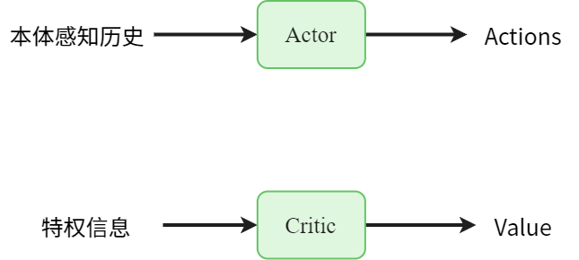

给actor输入多帧本体感知能够增强策略的鲁棒性，核心的insight是**本体感知的历史信息中包含了机器人状态随时间变化的规律，网络可以根据这些规律来应对更复杂的情况**（崎岖地形、受外力扰动等）。如果没有历史信息的话，网络只能根据当前时刻的感知来应对动态的环境，信息过于稀少。

#### 优势
- 实现简单

#### 缺点
- 训练效率低，学得慢

#### 代表性文章
- [Learning Agile Bipedal Motions on a Quadrupedal Robot](https://www.alphaxiv.org/abs/2311.05818)
- [OmniH2O: Universal and Dexterous Human-to-Humanoid Whole-Body Teleoperation and Learning](https://www.alphaxiv.org/pdf/2406.08858)

### 使用表征学习
使用表征学习的方法可以分为多种形式：
- Teacher-Student系列：使用teacher encoder编码与任务相关的物理状态，sutdent encoder根据本体感知的历史信息预测teacher encoder的编码。具体又可以分为不同的实现形式：

	- [原始Teacher-Student](https://www.alphaxiv.org/overview/2010.11251)：由ETH的Marco Hutter组提出的最原始的Teacher-Student实现，主要特点为两阶段训练，encoder和actor绑定在一起，二阶段蒸馏时用action loss来优化student的encoder和actor。
		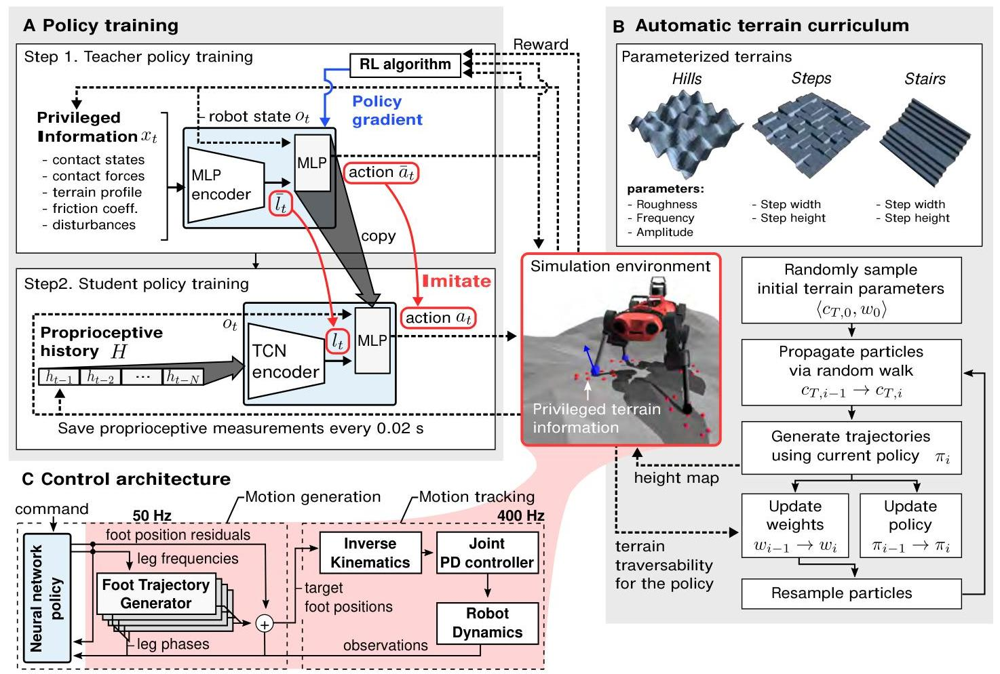

	- [RMA](https://alphaxiv.org/pdf/2107.04034)：CMU的Deepak Pathak组提出的Teacher-Student变体，仍然是两阶段训练，encoder和actor解绑，第一阶段训练完actor后第二阶段使用冻结的一阶段actor，二阶段蒸馏时用latent loss来优化student的encoder。
		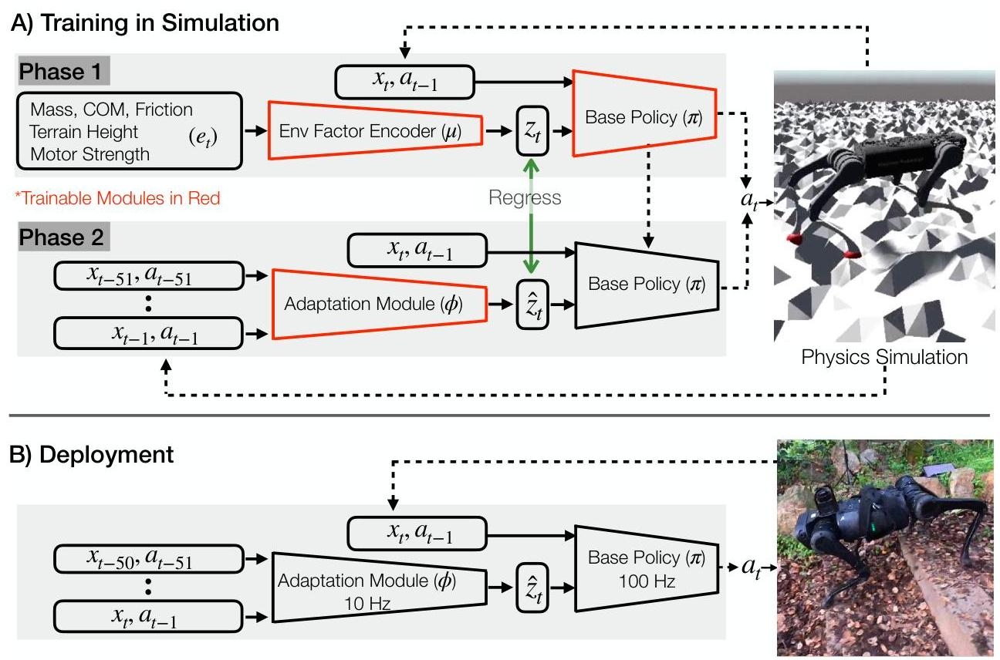

	- [RLvRL](https://www.alphaxiv.org/abs/2205.02824)：MIT的Pulkit Agrawal组提出的Teacher-Student变体，单阶段训练，依然是encoder和actor解绑，训练时用latent loss来优化student的encoder，用RL的loss来优化teacher encoder和actor。这种方式中student没有实际和环境交互，类似于behavior cloning的idea，得到的student policy的效果并不好。

	- [CTS](https://www.alphaxiv.org/abs/2405.10830)：SusTech的张巍组提出的并行Teahcer-Student方案，单阶段训练，最主要的创新是将env分为teacher和student两组，将RL loss中的surrogate loss形式化为teacher surrogate loss + student surrogate loss，从而在RL更新中同时考虑两者的return，实现互相反哺的效果。
		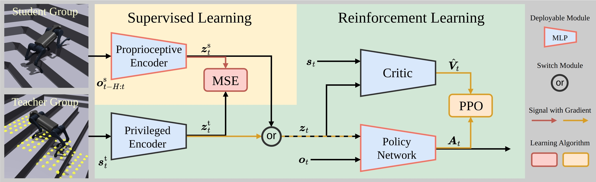

- [EstimatorNet](https://www.alphaxiv.org/abs/2202.05481)：KAIST的Jemin Hwangbo组提出的估计器网络方法，单阶段训练，核心idea是在训练中添加一个估计器网络，从本体感知的历史信息中估计出来真实物理状态（基座线速度、足端接触状态、足端相对于地面的高度等），将这个估计的信息输入给actor，使其可以有更高效的信息输入。
	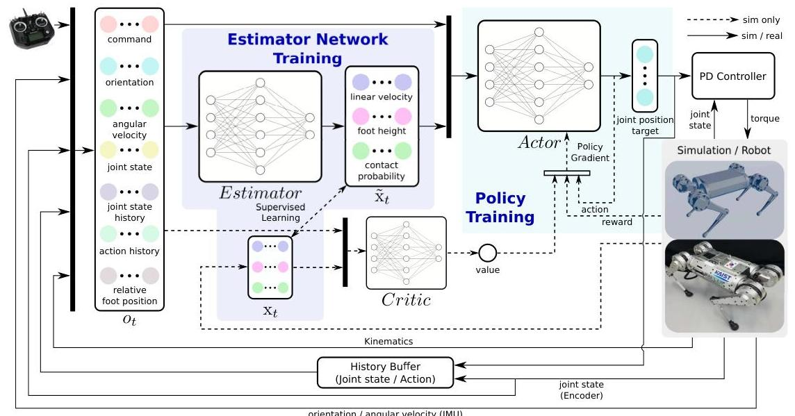

- [DreamWaQ](https://www.alphaxiv.org/abs/2301.10602)：KAIST的 Hyun Myung组提出的方法，通过预测下一步的observation来提取有效的中间表征，VAE的引入（与标准高斯分布的KL散度损失）使得隐变量聚集在一个超球面上，压缩了隐变量空间。
	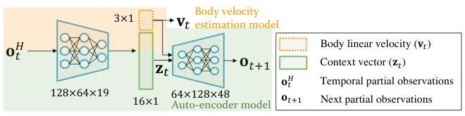

- Contrastive Learning：相比于预测数值的回归的方式，对比学习提供了另一种方式来让策略隐式地理解环境状态与动力学。
	- [HIMLoco](https://www.alphaxiv.org/abs/2312.11460)：上海AI Lab的庞江淼组提出的基于对比学习的盲走方案，单阶段训练，基于[SwAV](https://www.alphaxiv.org/abs/2006.09882)方法得到隐向量的高效表征。
		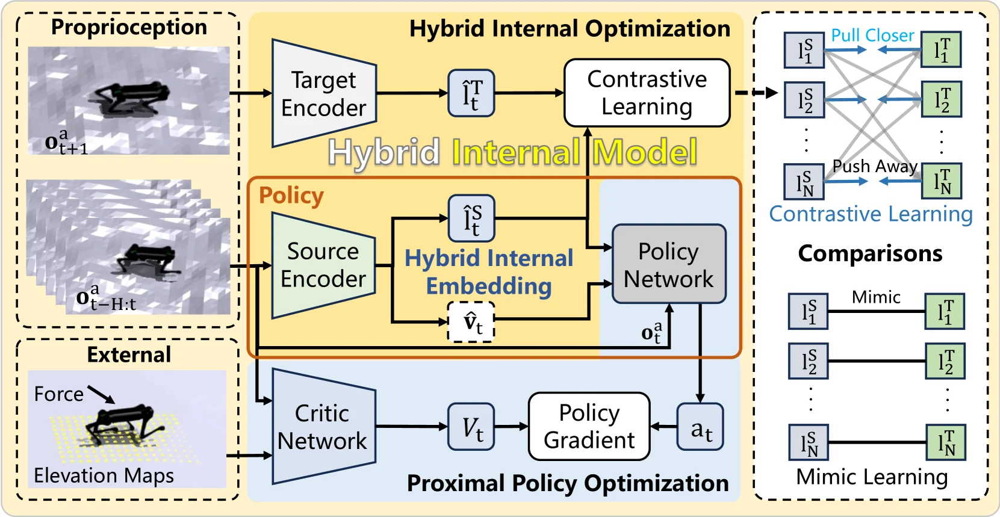
	
  - [PvP](https://www.alphaxiv.org/abs/2512.13093)：逐际动力的谌骅组提出的基于对比学习的盲走方案，单阶段训练，基于[SimSiam](https://www.alphaxiv.org/abs/2011.10566)方法得到隐向量的高效表征。
		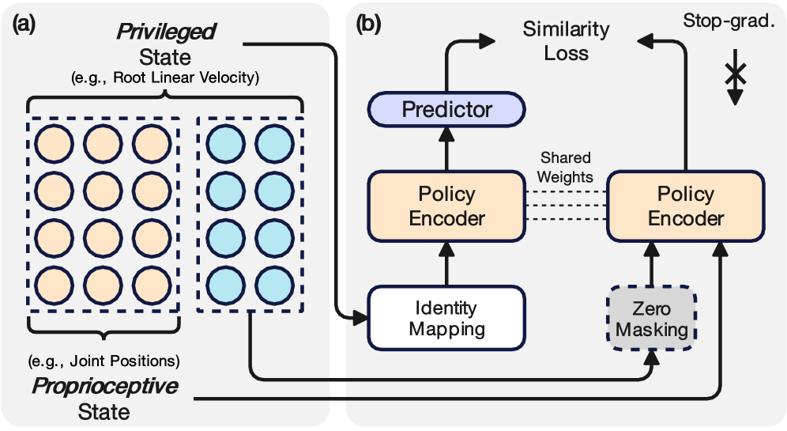

## perceptive_locomotion

> 这里的perceptive_locomotion只涉及深度图输入的运动控制策略

对于输入深度图的perceptive_locomotion来说，由于深度图的信息维度更高，冗余更多，所以不使用表征学习来提取低维有效表征所造成的训练效率低下会更显著。
这种任务的方法同样可以分为不使用表征学习和使用表征学习两大类。

### 不使用表征学习
与blind_locomotion类似，这类方法就是简单粗暴的将信息输入给网络。只不过在深度图方面，会引入CNN来处理图像。
这类方法的代表是[Hiking in the Wild](https://www.alphaxiv.org/abs/2601.07718)，通过AMP+MoE的框架来学习拟人的perceptive_locomotion动作。

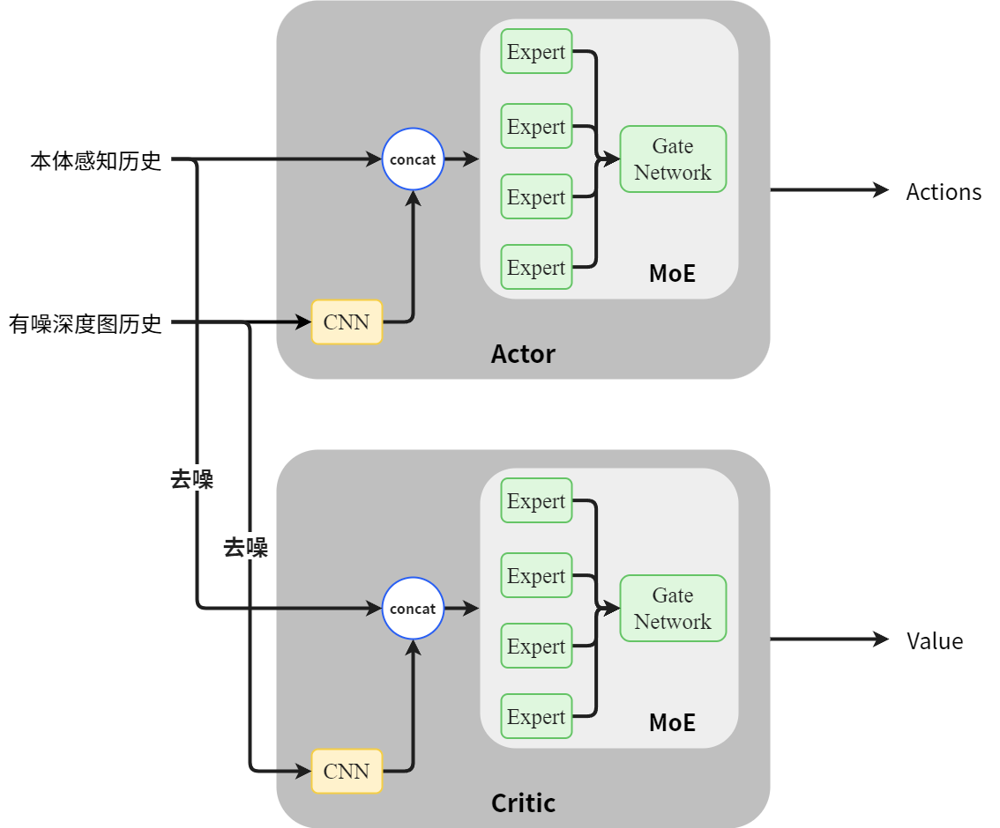

### 使用表征学习

很多使用表征学习的perceptive_locomotion方法就是在blind_locomotion的框架基础上拓展而来的。大概可以分为以下几类：

- Teacher-Student系列：
	- [RMA拓展](https://www.alphaxiv.org/abs/2211.07638)：CMU的Deepak Pathak组提出的方法，双阶段训练。论文中提出了两种训练方式，一种是直接沿袭RMA的方式，encoder和actor解耦，通过latent loss优化encoder；另一种是更贴合原始TS的方式，encoder和actor耦合，通过action loss优化encoder和actor。根据论文中展示的结果（Table 1），Monolithic的方式得到的student policy的性能更好。
		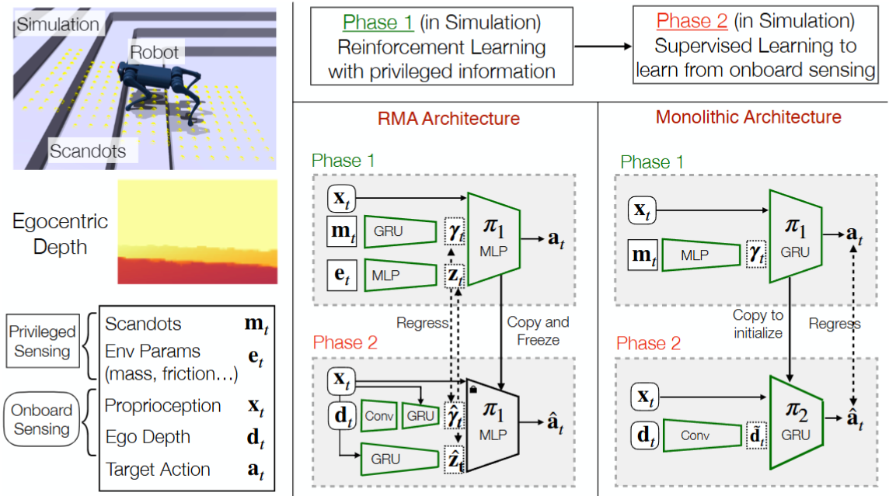
	
  - [Robot Parkour Learning](https://www.alphaxiv.org/abs/2309.05665)：清华的赵行组提出的方法，使用两阶段的teacher-student训练，二阶段蒸馏时使用了BCE loss来优化，因为网络的输出被tanh限制在了[-1,1]之间，并且经过`(1+a)/2`的变换最终到了[0,1]之间，覆盖概率的特征。本文的一个创新在于virtual obstacle的引入，实现快速的预训练。这一思想在后期的[Hiking in the Wild](https://www.alphaxiv.org/abs/2601.07718)中得到了继承，并利用[Nvidia warp](https://github.com/nvidia/warp)实现了更快速的穿透检测。
		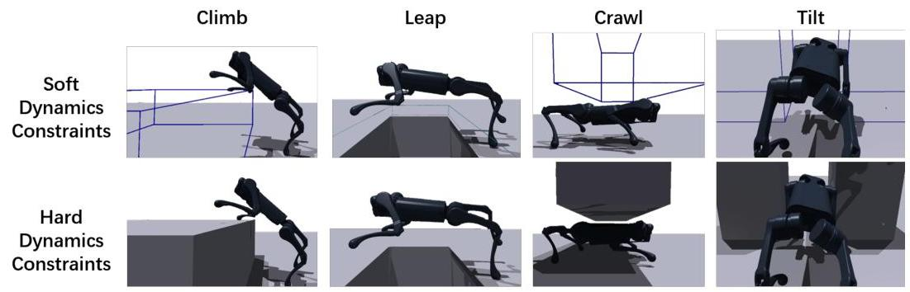
	
  - [Extreme Parkour](https://www.alphaxiv.org/abs/2309.14341)：CMU的Deepak Pathak组提出的方法，同样使用双阶段Teacehr-Student，利用action loss来优化encoder和actor。这篇文章中提出了用预定的落点来引导机器人的基座线速度命令，解决了velocity-based的policy在复杂地形上命令难以完美执行的问题。
		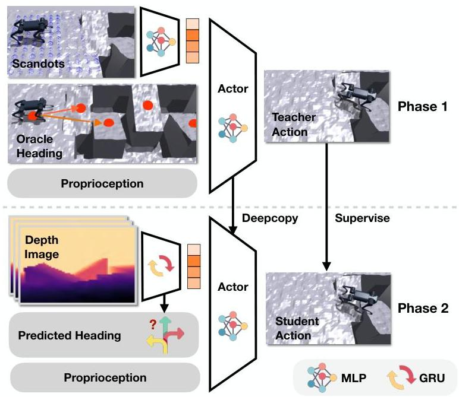
	
  - [带深度图的CTS](https://www.alphaxiv.org/abs/2509.09106)：南科大的张巍组提出的方法，在原始的盲走CTS的框架基础上拓展深度图的输入，利用decoder来进一步约束latent的表征。
		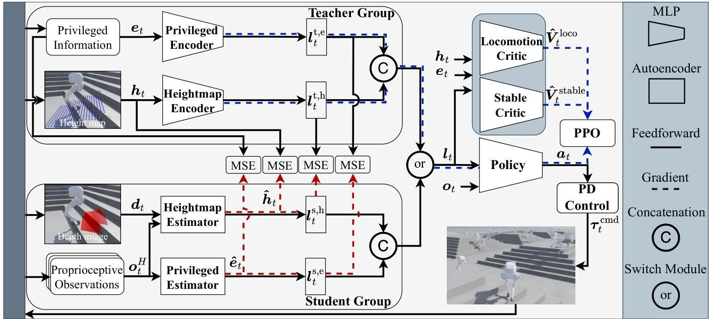

- EstimatorNet系列：这一系列的工作沿袭了EstimatorNet的**估计物理状态**的思想，在perceptive_locomotion的任务中用容易获得的深度图估计高效的地形表征。

	- [Cassie Perceptive Locomotion](https://www.alphaxiv.org/abs/2309.14594)：OSU的Alan Fern组提出的方法，主要idea是利用向前看的一个depth image来拟合机器人周身的heightmap，通过网络参数和仿真数据的scale，让单个视角的深度图也能拟合出来较为真实的heightmap。
		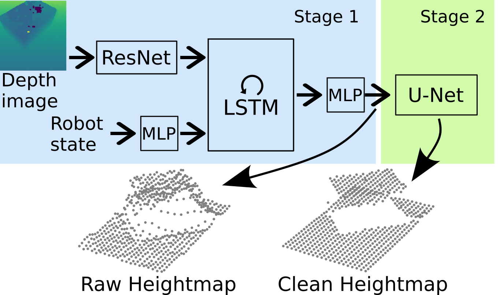
	
  - [NSR](https://www.alphaxiv.org/abs/2206.08077)：ETH的Marco Hutter组提出的方法，用四足机器人前后左右四个深度相机拟合机器人周身360°的heightmap。策略在训练直接输入仿真中获取的heightmap，实物上直接输入拟合到的heightmap即可。
		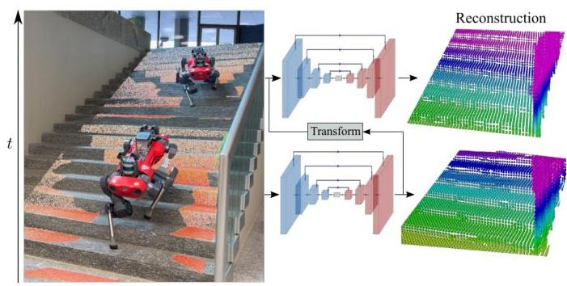
	
  - [START](https://www.alphaxiv.org/abs/2512.13153)：浙大的朱秋国组提出的方法，用向前看的深度相机拟合机器人前方的heightmap
		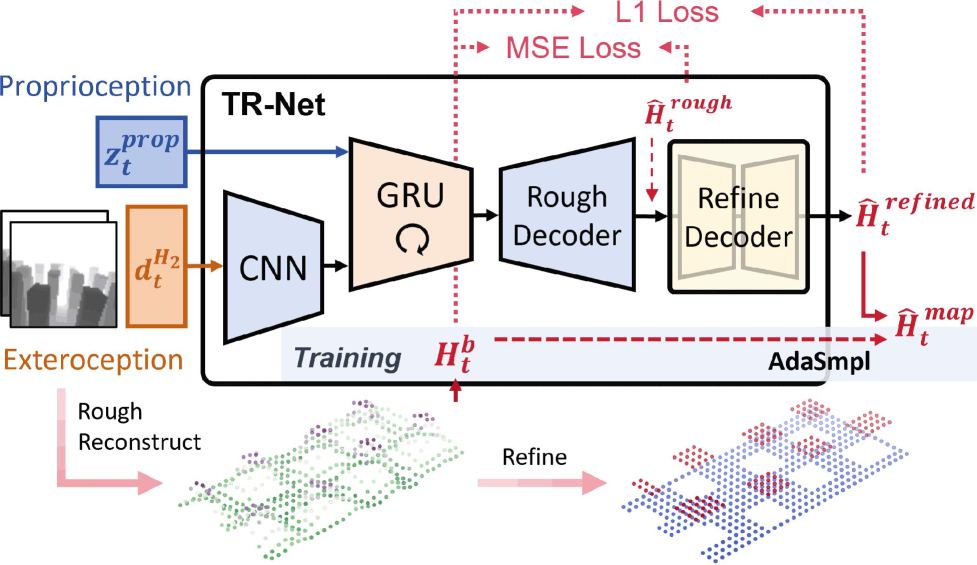
	
  - [Gait-Adaptive Perceptive Humanoid Locomotion with Real-Time Under-Base Terrain Reconstruction](https://www.alphaxiv.org/abs/2512.07464)：逐际动力的谌骅组提出的方法，同样使用U-Net来拟合高度图
		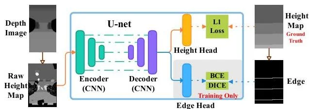

- DreamWaQ拓展：
	- [PIE](https://www.alphaxiv.org/abs/2408.13740)：浙大的朱秋国组提出的方法，沿袭了[DreamWaQ](https://www.alphaxiv.org/abs/2301.10602)的思路，利用VAE架构，通过拟合下一帧的obs以及当前的heightmap来获取中间表征
		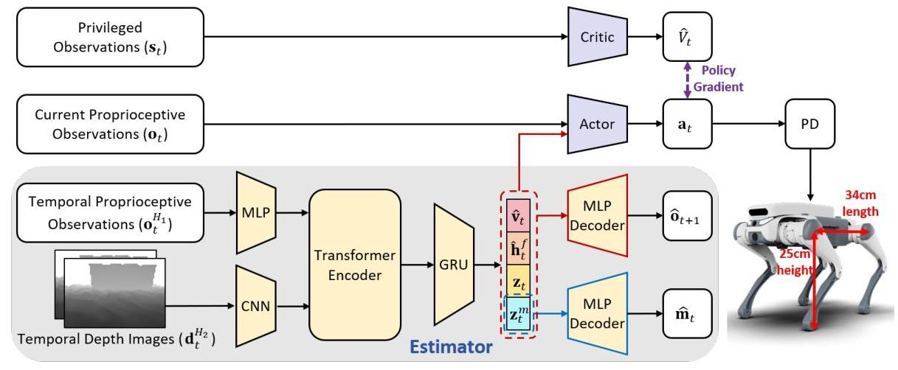

- 世界模型系列：
	- [WMP](https://www.alphaxiv.org/abs/2409.16784)：上交的张伟楠组提出的方法，利用[Dreamer](https://www.alphaxiv.org/abs/2010.02193)中提出的RSSM架构作为world model的架构，通过预测下一帧的深度图和本体感知来提取中间表征。
		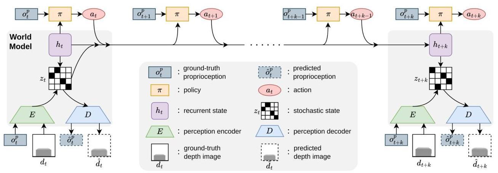