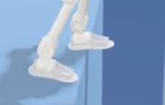
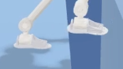
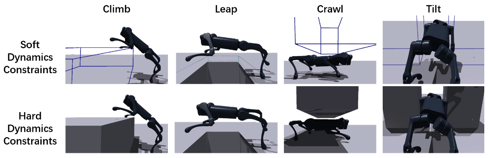
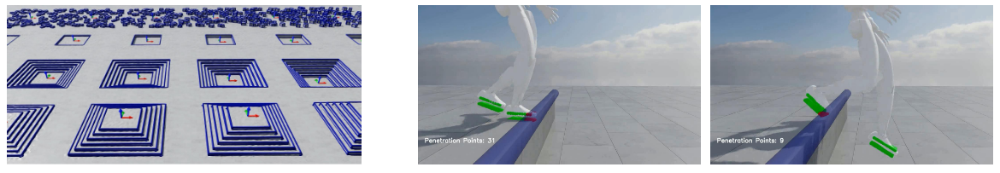
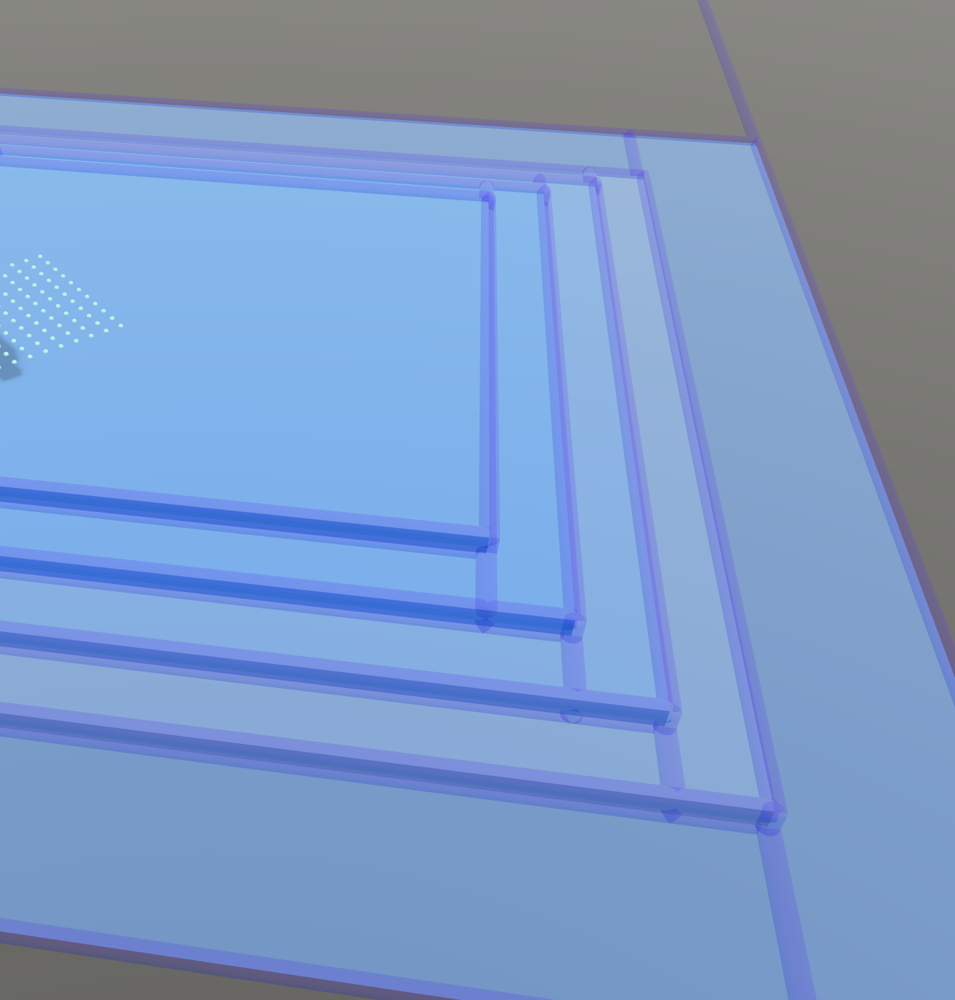
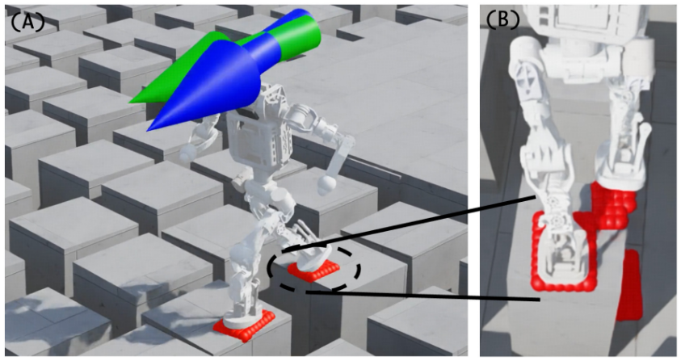
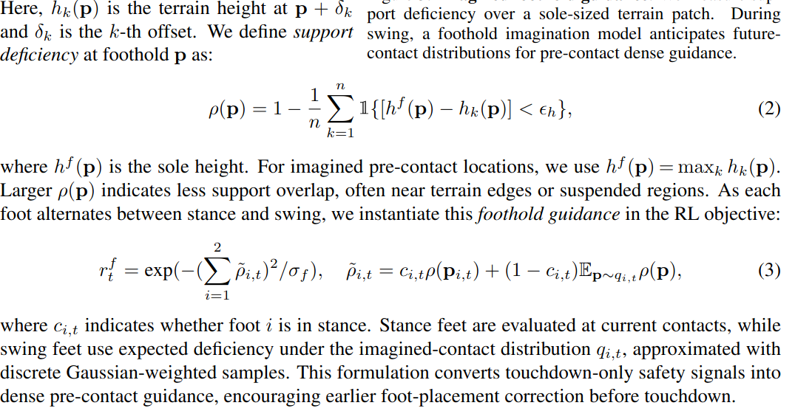

对于有脚掌的足式机器人来说，足端的落脚点对于机器人行走的安全性与稳定性至关重要。不安全的落脚点造成的稳定性隐患在实机上由于sim2real gap会被进一步放大，导致实机上无法稳定穿越复杂地形。下表给出了一个不安全/安全落脚点的对比。

| 不安全的落脚点 | 安全的落脚点 |
| ------------ | ---------- |
|  |  |

为了鼓励策略学习安全的落脚点，已有的工作提出了多种方法。本文介绍几种典型思路及其原理。

## Virtual Obstacles

Virtual Obstacle（虚拟障碍物）是Ziwen Zhuang提出的一种让足式机器人的落脚点远离不安全的地形边缘的方法。该方法的雏形在[Robot Parkour Leanring](https://www.alphaxiv.org/pdf/2309.05665) 中被提出，最初是作为Soft Dynamics Constraints让策略不需创建实际的刚体就能快速学会对应的动作。



后来在[Hiking in the Wild](https://www.alphaxiv.org/pdf/2601.07718) 中被改编为惩罚特定体积点穿透地形的虚拟障碍物，结合真实的刚体地形来让双足机器人学习安全的落脚点。早期Robot Parkour Learning中的虚拟障碍物是直接建模一整个虚拟物体，并惩罚机器人的mesh穿透这些虚拟物体。Hiking iin the wild中的虚拟障碍物是对地形进行边缘检测，在边缘处添加虚拟圆柱体，通过惩罚足端附着的体积点与圆柱体的穿透来鼓励安全的落脚点。



### 原理解析

Volume points penetration 不是直接检测刚体 contact，而是在机器人脚部（或指定 body）内部预先布置一组**局部体积采样点**：

1. 每个 control step 把局部采样点变换到世界坐标；
2. 对每个点检测它是否进入台阶边缘等**虚拟障碍物**；
3. 计算点到障碍物表面的穿透深度；
4. 对所有穿透点做求和/加权惩罚。

它解决的是普通 contact sensor 的两个问题：

- 脚底还没有发生真实碰撞时，无法提前惩罚“即将蹭到台阶边缘”；
- 单纯 point/contact penalty 很难表达“脚的某个体积区域已经进入障碍物”。

```text
terrain / heightfield
        │
        ▼
virtual edge cylinders  ──────┐
                              │
robot body pose               │
        │                     ▼
        ▼             CylinderSpatialGrid
local volume points ──► world points
        │                     │
        ▼                     ▼
 point velocities      penetration_offset
        └──────────┬──────────┘
                   ▼
      volume-point penetration reward
```

#### 1. 体积点 Volume Points
##### 1.1 局部点阵
点阵由 `Grid3dPointsGeneratorCfg` 定义，在 body 局部坐标系中生成：

```python
Grid3dPointsGeneratorCfg(
    x_min=-0.08,
    x_max=0.17,
    x_num=10,
    y_min=-0.05,
    y_max=0.05,
    y_num=4,
    z_min=-0.06,
    z_max=-0.03,
    z_num=2,
)
```

C2 VPP 的配置在每只 `ankle_roll` 上生成：

```text
10 × 4 × 2 = 80 points/foot
2 feet     = 160 points/env
```

点阵被限制在足底附近的薄层，避免把整个腿部都当作体积点。

##### 1.2 世界坐标变换
`VolumePoints._refresh_volume_points()` 读取 body 的 `xpos` / `xquat`，把局部点阵变换到世界坐标：

```python
points_pos_w = math_utils.transform_points(
    self._volume_points_pattern.unsqueeze(0).expand(N_B, -1, -1),
    self._sensor_data.pos_w[env_ids].flatten(0, 1),
    self._sensor_data.quat_w[env_ids].flatten(0, 1),
).reshape(
    *self._sensor_data.pos_w[env_ids].shape[:2],
    self._sensor_data.point_num_each_body,
    3,
)
```

点速度由 body 的线速度和角速度共同计算：

```python
points_vel_w = body_vel_w.unsqueeze(-2).expand_as(points_pos_w).clone()
points_vel_w += torch.linalg.cross(
    body_ang_vel_w.unsqueeze(-2),
    points_pos_w - body_pos_w.unsqueeze(-2),
    dim=-1,
)
```

即：

```text
v_point = v_body + ω_body × (p_point - p_body)
```

这样脚转动时，即使 body 线速度为零，脚边缘的点也会有非零速度。

##### 1.3 数据结构
`VolumePointsData` 的主要张量形状：

| 字段 | shape | 含义 |
|---|---|---|
| `pos_w` | `[N, B, 3]` | body 世界位置 |
| `quat_w` | `[N, B, 4]` | body 世界姿态，wxyz |
| `vel_w` | `[N, B, 3]` | body 世界线速度 |
| `ang_vel_w` | `[N, B, 3]` | body 世界角速度 |
| `points_pos_w` | `[N, B, P, 3]` | 每个体积点的世界位置 |
| `points_vel_w` | `[N, B, P, 3]` | 每个体积点的世界速度 |
| `penetration_offset` | `[N, B, P, 3]` | 穿透偏移向量 

其中：

- `N`：环境数
- `B`：挂载 volume points 的 body 数
- `P`：每个 body 的点数


#### 2. 虚拟障碍物与穿透计算
##### 2.1 地形边缘圆柱
从地形高度场/mesh 中检测尖锐边缘，并生成虚拟圆柱：

```python
edge_obstacle_cfg = GreedyconcatEdgeCylinderCfg(
    cylinder_radius=0.04,
    min_points=2,
    component_workers=0,
    merge_collinear_gap=0.09,
    merge_collinear_angle_threshold=30.0,
    merge_collinear_line_distance=0.04,
)
```

地形配置：

```python
cfg.scene.terrain.virtual_obstacles = {"edges": edge_obstacle_cfg}
cfg.scene.terrain.virtual_obstacle_use_heightfield = True
cfg.scene.terrain.virtual_obstacle_raycast_resolution = 0.05
cfg.scene.terrain.virtual_obstacle_raycast_backend = "gpu"
cfg.scene.terrain.virtual_obstacle_raycast_riser_threshold = 0.04
```

这些圆柱是**虚拟障碍物**：

- 不参与物理碰撞；
- 不产生真实接触力；
- 只用于计算 volume points 的穿透深度和奖励。

>[!note]- 虚拟障碍物的地形源选择
> 虚拟障碍物的边缘检测使用了地形的trimesh，如果使用mjlab内置的trimesh地形的话，由于其是使用box组合而成的trimesh，在平地上会有一些拼接导致的额外边界。所以在检测边缘时会有一些错误的边缘被检测出来，这时候可以将trimesh先转换为heightfield，然后再检测边缘。
> 

##### 2.2 注册到 sensor
通过 startup event 把地形虚拟障碍物注册到 sensor：

```python
cfg.events["register_virtual_obstacles"] = EventTermCfg(
    func=envs_mdp.register_virtual_obstacle_to_sensor,
    mode="startup",
    params={"sensor_cfgs": SceneEntityCfg("leg_volume_points")},
)
```

`VolumePoints.register_virtual_obstacles()` 保存 `terrain.virtual_obstacles` 字典。

##### 2.3 每个点的穿透偏移
`VolumePoints._refresh_penetration_offset()` 对所有虚拟障碍物查询穿透偏移，并保留**穿透深度最大的圆柱**：

```python
penetration_offset_buf[:] = 0.0
penetration_depth_buf = torch.zeros_like(penetration_offset_buf[..., 0])

for virtual_obstacle in self._virtual_obstacles.values():
    penetration_offset = virtual_obstacle.get_points_penetration_offset(
        self._sensor_data.points_pos_w[env_ids].flatten(0, 2)
    )
    penetration_offset = penetration_offset.reshape(
        self._sensor_data.points_pos_w[env_ids].shape
    )
    penetration_depth = torch.norm(penetration_offset, dim=-1)
    mask = penetration_depth > penetration_depth_buf
    penetration_depth_buf[mask] = penetration_depth[mask]
    penetration_offset_buf[mask] = penetration_offset[mask]
```

##### 2.4 圆柱穿透 kernel
`CylinderSpatialGrid` 先用 3D spatial grid 找到附近圆柱，再在 Warp kernel 中计算：

```python
ab = b - a
ab_len = wp.length(ab)
ab_dir = ab / ab_len
ap = p - a
t = wp.dot(ap, ab_dir)

if t < 0.0 or t > ab_len:
    continue

proj = a + t * ab_dir
dist = wp.length(p - proj)

if dist < r:
    d = r - dist
    if d > depth:
        depth = d
        offset_ = (proj - p) * (d / dist)
```

含义：

- 点先投影到圆柱轴线段；
- 如果点超出圆柱端面，直接跳过；
- `dist` 是点到轴线的距离；
- `r - dist` 是穿透深度；
- `penetration_offset` 的长度就是穿透深度，方向从圆柱表面指向点。

#### 奖励计算
代码：

```python
def volume_points_penetration_velocity(
    env,
    sensor_name: str,
    tolerance: float = 0.0,
):
    volume_sensor: VolumePoints = env.scene[sensor_name]
    penetration = volume_sensor.data.penetration_offset.flatten(1, 2)
    penetration_depth = torch.norm(penetration, dim=-1)
    in_obstacle = (penetration_depth > tolerance).float()
    points_vel = volume_sensor.data.points_vel_w.flatten(1, 2)
    points_vel_norm = torch.norm(points_vel, dim=-1)
    velocity_times_penetration = (
        in_obstacle * (points_vel_norm + 1e-6) * penetration_depth
    )
    return torch.sum(velocity_times_penetration, dim=-1)
```

数学形式：

```text
d_i = ||penetration_offset_i||
m_i = 1[d_i > tolerance]
R_vel = Σ_i m_i * (||v_point_i|| + ε) * d_i
```

特点：

- 静止但穿透的点：有惩罚；
- 正在运动且穿透的点：惩罚更大；
- 鼓励机器人主动远离障碍物，而不是维持穿透状态。

### 优缺点
优点：
1. 在接触前就有奖励引导运动。

缺点：
1. 用这个奖励在人形机器人上学习上台阶，容易学出来往前顶脚的行为。脚掌前方容易顶到台阶立面。


## Foot Gradient Penalty
这个方法利用足端附着的`RayCastSensor`来测量脚底的地面相对于脚底的高度，并惩罚脚底地面高度过低或梯度过大。
这类方法在[Light-Loco-Parkour](https://www.alphaxiv.org/pdf/2608.02653)和[SOLO](https://www.alphaxiv.org/pdf/2608.26583) 中都有用到。


### 优缺点
优点：
1. 奖励构建起来简单

缺点：
1. 只在接触时有奖励，在腾空相没有奖励。奖励比较稀疏。

## Imagined Foothold
这个思路在[SSR](https://www.alphaxiv.org/pdf/2605.30770) 中被提出，主要思路是将只在接触时才有奖励的Foot Gradient Penalty变为接触和腾空时都有奖励。
而这则是通过预测未来落脚点来实现的。在SSR中，框架会训练一个foothold imagination model，预测未来的落脚点$\mathbf{p}$，对于支撑相的足端，会鼓励其足端heightscan的高度接近足端高度；而对于摆动相的足端，则会鼓励其未来落脚点的heightscan的高度接近足端高度，这样就实现了在支撑相和摆动相都有奖励来引导落脚。


### 优缺点
优点：
1. 奖励密集，可能有助于加速学习

缺点：
1. 落脚点的监督目标文中没有详细解释，可能需要根据某种规则来构建，训练会更加复杂